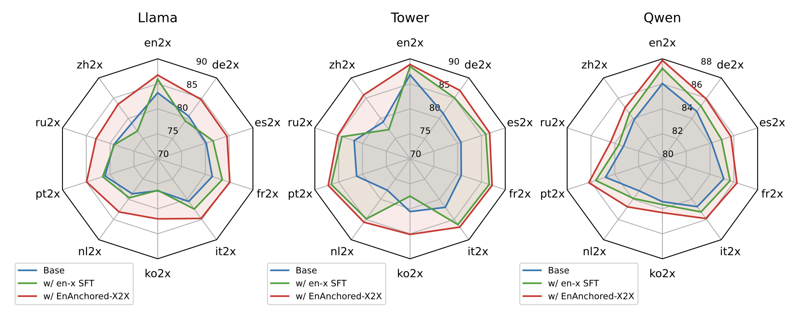
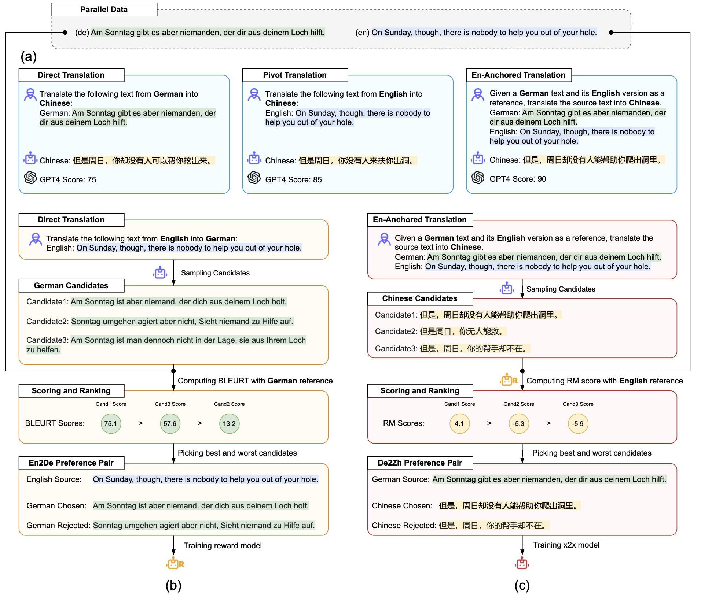

# ⚓EAX

<a href="https://arxiv.org/abs/2509.19770">
  </a>
<a href="https://huggingface.co/collections/double7/enanchored-x2x-6830338f017061c30226107d">
  </a>
<a href="LICENSE">
  </a>


English-Anchored Optimization for Many-to-Many Translation (EAX) augments direct non-English→non-English (x2x) translation in LLMs by leveraging strong English-centric abilities. EAX synthesizes omnidirectional training data with English references, scores it using an English-anchored reward model, and optimizes models via preference learning. Codes, datasets, and checkpoints are released for reproducibility.

## Overview

- Problem: LLMs trained with English-centric data excel at `en↔x` but underperform on direct `x↔x` translation.
- Insight: Use English as an anchor at generation and evaluation time to bootstrap high-quality `x↔x` data from existing `en↔x` corpora.
- Method: Combine English-Anchored x2x Translation (EAxT), English-Anchored x2x Evaluation (EAxE) via reward modeling, and preference-based optimization (DPO).
- Scope: 72 `x↔x` directions across 9 languages on FLORES-200.


COMET22 performance on FLORES-200 testset:


## Method Overview

- English-Anchored x2x Translation (EAxT): provide both non-English source and its English reference to the model when translating into a target non-English language; improves output quality over direct or pivot-only translation.
- English-Anchored x2x Evaluation (EAxE): train a reward model on `en→x` preference pairs and score `x→y` candidates via their English reference as a proxy.
- Preference Construction: sample multiple candidates per `x→y`, score with EAxE, keep best and worst to form pairs; filter by margin for high-confidence preferences.
- Optimization: train with Direct Preference Optimization (DPO) for stronger generalization than SFT.

The overview of EAX. Based on existing parallel data, the comparison of three methods for synthesizing x2x translation data (a), the process of constructing reward model for en2x evaluation (b) and the x2x preference data construction (c):


## Performance Overview

### BLEURT / COMET on FLORES-200

| Model (7B)         | en→x (SFT) | en→x (EAX) | x→x (SFT) | x→x (EAX) |
|--------------------|------------|------------|-----------|-----------|
| Llama2-7B          | 72.05 / 85.91 | 73.06 / 86.74 | 61.92 / 80.05 | 68.91 / 83.96 |
| TowerBase-7B       | 76.14 / 88.46 | 76.73 / 88.86 | 68.17 / 83.81 | 72.95 / 86.30 |
| Qwen2.5-7B         | 74.00 / 87.23 | 74.96 / 87.87 | 70.20 / 84.72 | 71.44 / 85.39 |

### GPT-4 evaluation on FLORES-200

| Model                 | x2en  | en2x  | x2x   | AVG   |
|-----------------------|-------|-------|-------|-------|
| Llama2-7B SFT         | 90.22 | 82.30 | 77.85 | 79.54 |
| Llama2-7B w/ EAX      | 90.32 | 83.94 | 82.51 | 83.43 |
| TowerBase-7B SFT      | 91.94 | 89.41 | 86.69 | 87.48 |
| TowerBase-7B w/ EAX   | 91.88 | 89.92 | 89.19 | 89.53 |
| Qwen2.5-7B SFT        | 91.94 | 85.99 | 86.37 | 86.89 |
| Qwen2.5-7B w/ EAX     | 92.00 | 87.16 | 86.93 | 87.46 |


## Getting Started

### Installation

> [!IMPORTANT]
> Installation is mandatory.

#### Install from Source

```bash
git clone https://github.com/NJUNLP/EAX.git
cd EAX
pip install -e ".[infer]" --no-build-isolation
```

Extra dependencies available:
- `infer`: install vllm for sampling.
- `eval`: comet, sacrebleu and bleurt for evaluation. Also, bleurt is required for Reward Modeling.

### x2x Optimization Pipeline

The pipeline includes the following steps:
1. [Supervised Fine-tuning](recipes/sft.md): setup the translation model with supervised data.
2. [Reward Modeling](recipes/rm.md): build translation evaluation capabilities for the SFT model through Reward Modeling.
3. [x2x Optimization](recipes/xpo.md): optimize x2x translation with English-Anchored Generation and Evaluation.

### Evaluation on FLORES

Setup the flores dataset:
```bash
wget https://tinyurl.com/flores200dataset -O flores200dataset.tar.gz
tar -xzvf flores200dataset.tar.gz
ls flores200_dataset
```

Evaluate the model on flores dataset and log the results to wandb:
```bash
python3 eval/run_eval_flores.py \
  --model_path path/to/model \
  --model_name model_name_for_logging \
  --test_data_path flores200_dataset \
  --split devtest \
  --metrics ["bleurt","sacrebleu","comet"] \
  --bleurt_path BLEURT-20 \
  --comet_path wmt22-comet-da/checkpoints/model.ckpt \
  --log_to_wandb True
```

> [!TIP]
> set `--log_to_wandb False` if wandb is not available and the results are logged to console.

> [!IMPORTANT]
> Do not evaluate our models on flores `dev` split as it is included in the [Towerblocks](https://huggingface.co/datasets/Unbabel/TowerBlocks-v0.1) dataset for training.

### Evaluation on custom dataset

You can evaluate the model on custom dataset by preparing the inference data in the following format:
```json
[
  {
    "src_lang": "en",
    "trg_lang": "zh",
    "src_text": "\"We now have 4-month-old mice that are non-diabetic that used to be diabetic,\" he added.",
    "trg_text": "他补充道：“我们现在有 4 个月大没有糖尿病的老鼠，但它们曾经得过该病。”",
  },
  ...
]
```

Run the evaluation:
```bash
python3 eval/run_eval.py \
  --model_path path/to/model \
  --infer_data_path path/to/infer_data.json \
  --metrics ["bleurt","sacrebleu","comet"] \
  --bleurt_path BLEURT-20 \
  --comet_path wmt22-comet-da/checkpoints/model.ckpt \
  --log_to_wandb True \
  --config '{"model_name": "qwen7b_eax"}' # any info that you want to log to wandb
```


## Citation 

```bibtex
@misc{yang2025enanchoredx2xenglishanchoredoptimizationmanytomany,
      title={EnAnchored-X2X: English-Anchored Optimization for Many-to-Many Translation}, 
      author={Sen Yang and Yu Bao and Yu Lu and Jiajun Chen and Shujian Huang and Shanbo Cheng},
      year={2025},
      eprint={2509.19770},
      archivePrefix={arXiv},
      primaryClass={cs.CL},
      url={https://arxiv.org/abs/2509.19770}, 
}
```
